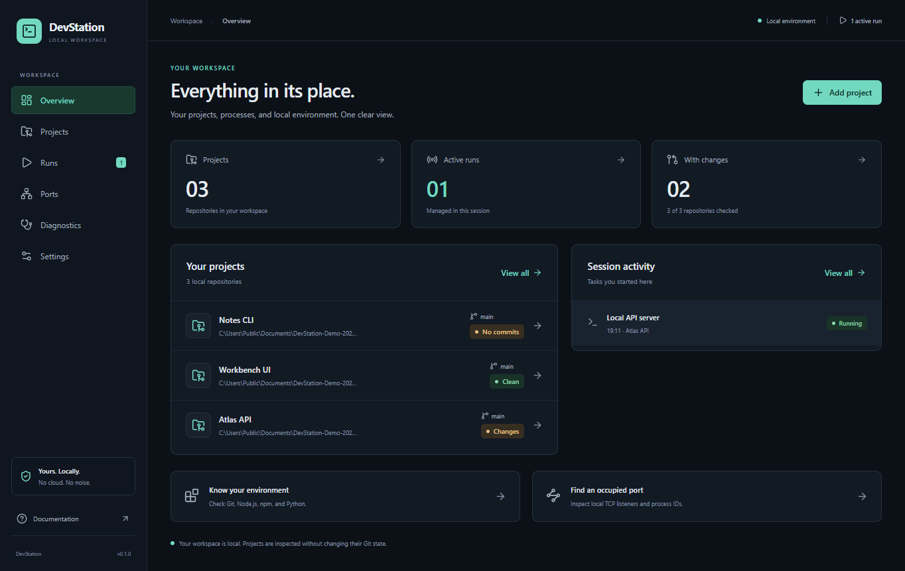
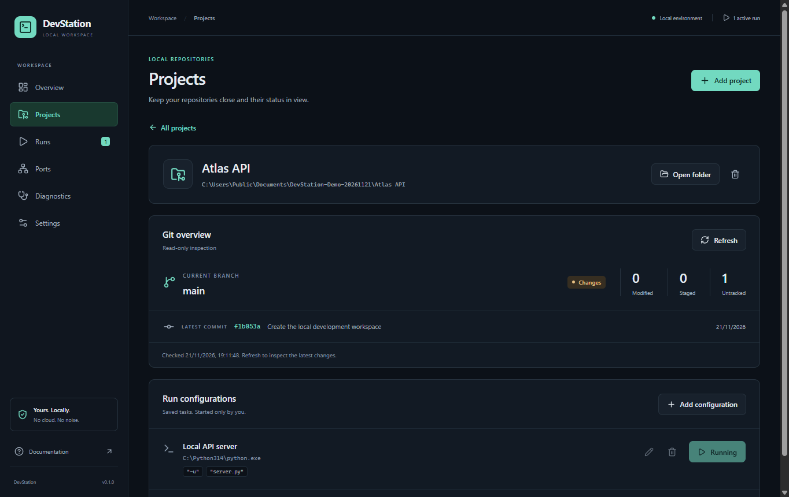
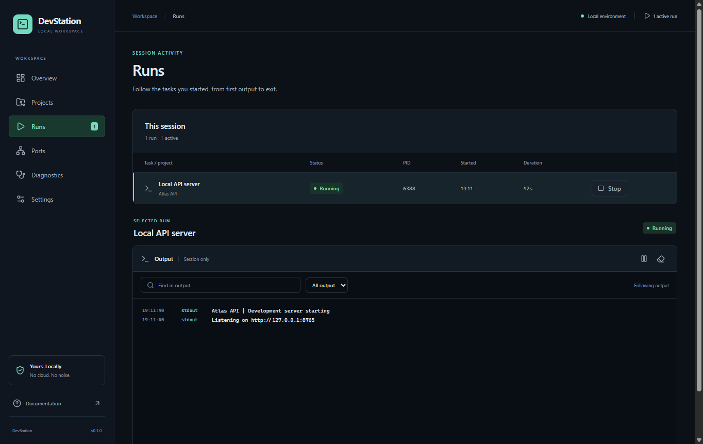

# DevStation

**Your local development workspace, in one place.**

DevStation is a Windows desktop workspace for local Git projects, explicit run configurations, process output, environment diagnostics, and listening TCP ports. It uses Electron, React, TypeScript, and SQLite.

**Status: functional v0.1.0 preview; final local distribution acceptance incomplete.** Windows CI passes all 53 unit/integration/React tests and 3 desktop tests, including the hardened package, with build artifacts and checksums uploaded privately. The latest local unsigned executable is blocked by this host's Smart App Control signing policy. Trusted signing/distribution and a fresh local launch check remain required. No Windows protection was disabled or bypassed.

An earlier local package passed native project import, executable selection, confirmed Start/Stop, real Python logs, TCP inspection, and a cancelable active-run close prompt. Its desktop tests verified startup without external Node and SQLite preference persistence. The screenshots below capture that earlier tested artifact. The current compiled Electron workflow also verifies two-project restart persistence, configuration form submission, and focus restoration. The baseline development startup with `npm start` passed separately. Some acceptance cases remain untested, including full keyboard navigation, scaling, offline operation, and Windows 10. See [QA](docs/QA.md), the [current Windows run](https://github.com/Tyago03/DevStation/actions/runs/44960251660), and the [artifact/checksum record](docs/RELEASE.md). The repository remains private; no public release has been published.



The received briefing package repeats the original specification. Its [P0 roadmap](docs/ROADMAP.md) records remaining acceptance work. This iteration fixes fragmented logs, missing-output delays, Git root revalidation, misleading empty states after load errors, and keyboard/accessibility issues.

## First version

The implemented first-version modules cover:

- Importing local Git working trees, searching the project catalog, and opening project folders.
- Inspecting branch, changes, and the latest commit without changing the repository.
- Saving a trusted Windows `.exe`, separate arguments, and a working directory inside the project.
- Starting a configuration explicitly, reading stdout/stderr, and stopping its session-owned main process.
- Inspecting listening TCP ports and checking Git, Node.js, npm, and Python availability.
- Keeping projects, configurations, and appearance preferences in a local SQLite database.

The app has no account, AI service, cloud sync, telemetry, or automatic project execution. Git operations are read-only. Shell scripts (`.cmd`, `.bat`, and PowerShell profiles), `npm run`, arbitrary PID termination, and automatic updates are outside this version. npm diagnostics explicitly report **Not checked** because its Windows shell wrapper is unsupported.

## Screenshots

These capture the earlier locally tested packaged artifact (`677acfca…`), using synthetic repositories and a live test server. Atlas API was imported through the native folder dialog. The other two fixtures had their catalog metadata seeded in SQLite; their displayed Git states came from real repositories. They do not establish successful launch of the latest local artifact (`e74cb698…`) or manual import of all three fixtures.





## Development

Use Windows x64, Node.js 24 LTS, npm, and Git. Initial development uses Node 24.21.0, npm 11.19.0, and Git 2.55.0. Exact dependency versions are recorded in `package-lock.json`.

```powershell
npm ci
npm run typecheck
npm run lint
npm run test:unit
npm run test:integration
npm run test:ui
npm start
```

Build the Windows ZIP and run the desktop tests:

```powershell
npm run make
npm run test:e2e
```

The ZIP is written under `out/make/zip/win32/x64/`. When Windows policy allows the artifact, extract the complete archive before opening `DevStation.exe`; do not copy only the executable. Electron bundles its own runtime. Startup without external Node was verified on the earlier local package and in Windows CI, while the final local package is currently blocked before startup. Project tasks still need the executable you select, and Git inspection requires Git on the machine.

The preview is **unsigned**. The final local ZIP is also copied to Downloads as `DevStation-0.1.0-96e6c45-windows-x64.zip`; [its SHA-256](docs/RELEASE.md) identifies those exact bytes, not the separate CI archive. Follow your Windows software policy; do not disable protections to run a blocked artifact. No installer, code-signing certificate, or automatic updater is included.

Native SQLite must match the runtime that loads it. Forge rebuilds native dependencies for Electron during packaging; tests and packaging must follow the repository's scripts rather than copying a binary from another Node installation. See [troubleshooting](docs/TROUBLESHOOTING.md) for ABI and Windows policy errors.

## Safety and local data

Removing a project removes its DevStation registration and saved configurations; it does not delete the project folder. Runs require an explicit action and a confirmation. Their output stays in a bounded memory buffer for the current session.

Tasks execute with your Windows user permissions. Select only executables and projects you trust. Stopping a run targets its managed main process; child processes may remain running. The Ports page does not terminate processes.

SQLite lives under Electron's application `userData` directory, outside imported projects. Before a schema migration, preserve a database backup. No credentials or project file contents belong in the database. See [security design](docs/SECURITY.md) and [recovery instructions](docs/TROUBLESHOOTING.md).

## Documentation

- [P0 roadmap and briefing provenance](docs/ROADMAP.md)
- [Architecture](docs/ARCHITECTURE.md) and [technical decisions](docs/DECISIONS.md)
- [Design and interaction](docs/DESIGN.md)
- [Test evidence and acceptance matrix](docs/QA.md)
- [Packaging and release procedure](docs/RELEASE.md)
- [Troubleshooting](docs/TROUBLESHOOTING.md)
- [Security reporting](SECURITY.md)

Windows 10 compatibility, full process-tree termination, and broader platform support are not claimed. The complete list of unverified cases remains visible in QA.

## License

Original DevStation source is [MIT licensed](LICENSE). Third-party dependencies retain their own licenses. The dependency notice review is tracked separately in [THIRD_PARTY.md](docs/THIRD_PARTY.md).
