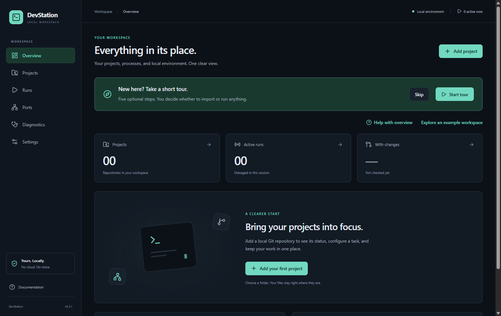
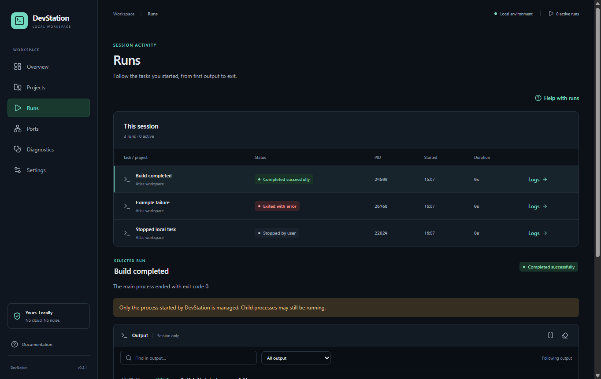

# DevStation

**Your local development workspace, in one place.**

Keep local Git projects, tasks, output and listening ports in a focused Windows desktop app. DevStation works with the folders and programs already on your computer, without an account or cloud service.

[Documentation](docs/README.md) · [Release records](docs/RELEASE.md) · [Contributing](CONTRIBUTING.md) · [Security](SECURITY.md)

**v0.2.1 pre-release candidate.** Twelve compiled desktop checks pass locally. The current unsigned packaged EXE is blocked by this machine's Windows signing policy. Main-branch CI and publication are pending; [QA](docs/QA.md) and the [build record](docs/RELEASE.md) distinguish these results.



Actual v0.2.1 compiled application with synthetic data. These captures do not establish packaged-EXE launch acceptance. [Offline help](docs/screenshots/v0.2.1-help.png) · [Example workspace](docs/screenshots/v0.2.1-demo.png)

## What you can do

- **Organize projects:** register existing Git folders and inspect their branch, changes and latest commit.
- **Run tasks deliberately:** configure Python scripts, Node.js scripts, a local Python web server or a selected Windows executable. Saving never starts a task.
- **Review changed scripts:** inspect the current file and explicitly authorize the new version before a separate Start action.
- **Follow execution:** read bounded, searchable output and distinguish a confirmed user stop, successful completion, error exit and uncertain status.
- **Inspect your environment:** check installed tools and local TCP listeners with clear failure and retry states.
- **Learn in place:** use searchable offline help, an optional tour and a synthetic example workspace that creates no files or processes.

Git inspection is read-only. Removing a project from DevStation leaves its folder and repository intact.

When a saved script changes, choose **Review changes and authorize**, inspect its current contents, then confirm **Authorize version** only if you trust the change. This updates the saved setup; **Start** is a separate action and confirmation. The app does not retain an old source snapshot, so the review shows the current file rather than a historical diff.



Actual compiled application showing synthetic task outcomes: successful completion, error exit and confirmed user stop.

## Install on Windows

The release format is a **portable Windows x64 ZIP**. The [intended v0.2.1 pre-release page](https://github.com/Tyago03/DevStation/releases/tag/v0.2.1) is pending publication. Consult the [build record](docs/RELEASE.md) for availability, exact checksums and the local signing-policy block; no stable or universal Windows compatibility is claimed.

For a published pre-release:

1. Download its Windows application ZIP and SHA-256 manifest from the same release. GitHub's automatically generated source archive is for building the project.
2. Compare the ZIP's hash with the manifest:

   ```powershell
   Get-FileHash -LiteralPath .\DevStation-windows-x64.zip -Algorithm SHA256
   ```

   Use the filename you downloaded.
3. Extract the **entire archive** into a folder you can write to, then open `DevStation.exe`.
4. Choose **Add project**, select a Git working folder and follow the optional tour. Create a launch setup, review it, Save, then Start only when ready.

The executable is **unsigned**, and the current package is blocked locally by Windows signing policy. Other machines may also warn about or block it. Follow your machine's software policy and keep Windows protections enabled. A checksum verifies file integrity; it does not establish a trusted publisher.

### Requirements

| Requirement | Details |
| --- | --- |
| Operating system | Windows 11 x64 is the validated target. Windows 10 is not yet validated; macOS/Linux packages are not provided |
| Window size | At least 1050 × 700 for the application window |
| Git | Git for Windows is needed to import and inspect repositories |
| Task programs | An installed Python or Node.js executable for its guided setup, or another trusted executable for Advanced |
| Runtime | The application ZIP includes Electron. Node.js and npm are not required merely to open it |

## Build from source

The stack is **Electron Forge, React, TypeScript, SQLite and Vite**. Vitest and Playwright cover service, interface and desktop behavior.

Use Windows x64, Node.js 24 LTS, npm and Git. The recorded toolchain uses Node 24.21.0; dependencies are locked in `package-lock.json`.

```powershell
git clone https://github.com/Tyago03/DevStation.git
cd DevStation
npm ci
npm start
```

Run the checks and build a portable ZIP:

```powershell
npm run typecheck
npm run lint
npm test
npm run make -- --arch=x64
npm run test:e2e
```

The build appears under `out/make/zip/win32/x64/`. Run Node-based tests before packaging because SQLite is rebuilt for Electron. See [Contributing](CONTRIBUTING.md) and [Troubleshooting](docs/TROUBLESHOOTING.md) for the development workflow and native-module recovery.

## Safety and known limits

Tasks run with **your Windows permissions**. Select programs and projects you trust. Script review detects changes in the selected file; it does not audit imported code or sandbox the task. Authorization never starts the script automatically.

Stop controls only the process started in this DevStation session. Descendants may remain running. Unconfirmed termination stays Unknown; restarting DevStation does not reclaim old processes. If a stop cannot be confirmed, the close flow offers retry or a separate **Quit anyway** confirmation.

The local web-server template binds to `127.0.0.1` and serves the selected folder to software on this computer. There are no Git writes, arbitrary-PID termination, automatic execution, telemetry, cloud synchronization or automatic updates. Built-in shell recipes are outside this release; npm's Windows wrapper is reported as **Not checked** in Diagnostics.

Projects stay in their original folders. SQLite stores local catalog/configuration/preferences; task output stays in bounded session memory. Removing the portable app preserves projects and separate application data. [Data and recovery](docs/TROUBLESHOOTING.md) · [Security design](docs/SECURITY.md)

Human usability sessions, physical offline operation, complete native-keyboard coverage and real Windows display scaling remain distinct from automated checks. See [QA](docs/QA.md) for PASS, FAIL and NOT RUN evidence, including exact source and artifact scope.

## Contribute

Focused bug reports, documentation improvements and pull requests are welcome. Use synthetic examples and remove personal paths and private logs. Read [Contributing](CONTRIBUTING.md); report vulnerabilities through the confidential route described in [Security](SECURITY.md).

## License

Original source is [MIT licensed](LICENSE), copyright Tyago Vitorino Ferreira. Dependencies retain their own [licenses and notices](docs/THIRD_PARTY.md). The Windows distribution includes the original MIT notice and the Electron/Chromium and dependency notices.
